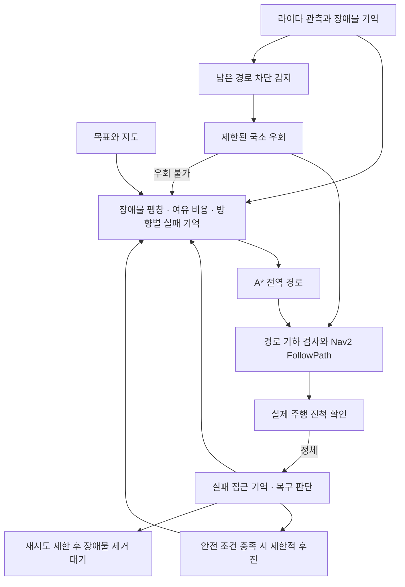

# A* 고도화 주행 알고리즘 · SMART-VISION-AMR

**격자 위에서 찾은 경로를 실제 로봇이 끝까지 주행할 수 있도록 확장한 A* 주행 모듈입니다.**
심화프로젝트 팀플에서 제가 담당한 A* 고도화 주행 알고리즘을 포트폴리오용으로 정리했습니다.
대상 플랫폼은 TurtleBot3 Waffle Pi, Ubuntu 22.04, ROS 2 Humble, Nav2입니다.

> 이 저장소는 [SMART-VISION-AMR 팀 최종본](https://github.com/kiki8105/SMART-VISION-AMR)에서
> 주행 관련 코드를 추출한 개인 포트폴리오입니다. 팀 전체 시스템을 개인 단독 개발 결과로
> 표현하지 않습니다. 추출 기준은 `ba81f454f8ca60d004cc4995c941337880fc02f5`이며,
> 파일별 원본 해시는 [출처 명세](docs/source_manifest.json)에 기록했습니다.

## 담당 범위와 저장소 구성

개인 담당 범위는 A* 경로 탐색 고도화와 장애물 변화·실행 실패에 대응하는 주행 알고리즘입니다.
이를 검토하고 연결할 수 있도록 경로 추종, 장애물 기억, 속도 명령 중재 및 상태 검사에 필요한
팀 통합 코드도 함께 보존했습니다. 포함된 모든 코드의 단독 저작권을 주장하는 의미는 아닙니다.

웹 UI, 배송·재고 임무, 카메라·ArUco, SLAM 구축, EKF 추정 파이프라인, Gazebo 시나리오,
팀 전체 발표자료는 현재 파일 구성에 포함하지 않았습니다. 기존 개인 저장소의 커밋 이력은 유지합니다.
`ekf_sensor_guard.py`는 주행 코드에서 참조하는 상태 판정 의존성으로만 포함하며 별도 실행 노드로 등록하지 않습니다.

## 어떤 문제를 해결했는가

| 주행 중 문제 | 구현한 대응 | 주요 코드 |
|---|---|---|
| 최단 경로가 벽 가까이를 통과함 | 장애물 팽창과 여유 거리 비용으로 통행 가능 영역과 선호 영역을 구분 | `astar.py`, `clearance_cost.py` |
| 이동 중 새로운 장애물이 나타남 | 현재 관측을 반영하고, 제한된 범위에서 원래 경로 앞쪽에 합류하는 국소 우회 시도 | `local_detour.py`, `astar_planner.py` |
| 경로는 있지만 같은 구간에서 계속 실패함 | 위치·헤딩 진척을 판단하고 실패한 진입 방향의 간선을 임시 제한 | `execution_progress.py`, `failure_memory.py` |
| 장애물 팽창 영역에서 시작하거나 후진이 필요함 | 차체 여유를 검사하는 출발 연결과 최근 궤적에 기반한 제한적 후진 복구 | `continuous_start_egress.py`, `metric_connector.py`, `reverse_recovery.py` |
| 장애물이 남아 있는데 무한히 재시도함 | 시도 횟수를 제한하고 실제 라이다 제거 확인 후 목표 재개 | `obstacle_hold.py`, `recovery_episode.py` |
| 경로 발행을 주행 성공으로 오인함 | Nav2 추종 상태와 실제 이동 진척을 함께 확인 | `path_follower.py`, `odometry_trail.py` |

핵심 구현은 [smart_vision_amr](ros2_ws/src/smart_vision_amr/smart_vision_amr)에 있습니다.

## 알고리즘 흐름



A*는 8방향 격자 탐색에 셀·간선 비용과 방향별 금지 간선을 적용합니다.
경로 스무딩도 장애물과 실패 간선 제한을 따라야 합니다. 원본 지도 PGM을 수정하는 대신
현재 장애물, 확정된 장애물 기억, 일시적인 실패 접근 기억을 분리해서 관리합니다.
후진·출발 예외는 원본 점유 장애물을 통과하도록 허용하는 기능이 아닙니다.

## ROS 없이 검증하기

Python 3.10 이상에서 저장소 루트 기준으로 실행합니다.

```bash
git clone https://github.com/waterhyunsu/SMART-VISION-AMR.git
cd SMART-VISION-AMR
python3 -m venv .venv
source .venv/bin/activate
python -m pip install -r requirements-dev.txt
python -m pytest -q
```

원본 테스트 중 ROS 초기화나 팀 전체 파일 구성을 요구하지 않는 기하·상태 판정 테스트를
선별했습니다. 방향별 간선 제한, 여유 비용, 국소 우회 합류, 출발 충돌 검사, 실패 기억,
후진 복구 및 복구 상태 전이를 검증합니다. 추출본의 검증 범위는 [검증 기록](docs/VALIDATION.md)에 있습니다.

## ROS 2 패키지 빌드

Ubuntu 22.04 / ROS 2 Humble 환경에서 실행합니다.

```bash
source /opt/ros/humble/setup.bash
cd ros2_ws
rosdep install --from-paths src --ignore-src -r -y
colcon build --symlink-install
source install/setup.bash
```

C++ 기하 계산 확장은 선택 사항이며, 빌드되지 않으면 Python/NumPy 경로를 사용합니다.
패키지는 알고리즘과 주행 연결 노드를 제공합니다. 로봇 bringup, 지도 서버·AMCL,
Nav2 controller와 실제 하드웨어 실행 환경은 별도로 준비해야 합니다.
팀의 전체 실행 환경은 [원본 저장소](https://github.com/kiki8105/SMART-VISION-AMR)를 참고하세요.
이 추출본에는 전체 시스템을 자동 기동하는 하드웨어 런치를 제공하지 않습니다.

## 기존 Nav2 환경에 연결하기

주행 연결에 필요한 입력과 출력은 다음과 같습니다.

| 인터페이스 | 역할 |
|---|---|
| `/map`, `map → odom → base_footprint` TF | 지도와 로봇 위치 |
| `/scan`, `/odom`, `/amcl_pose` | 장애물 관측·진척·위치 상태 검사 |
| `/smart_vision_amr/goal` | `geometry_msgs/PoseStamped` 목표 입력 |
| `/smart_vision_amr/path` | A*가 생성한 `nav_msgs/Path` |
| `/follow_path` | Nav2 `FollowPath` action |
| `/local_costmap/costmap`, `/local_costmap/published_footprint` | 추종 전 검사 입력 |
| `/smart_vision_amr/navigation_cmd_vel` | Nav2 최종 속도 출력을 연결할 토픽 |
| `/smart_vision_amr/navigation_control` | `command_stamper`가 생성하는 시각·순번 포함 명령 |
| `/smart_vision_amr/motion_status`, `/smart_vision_amr/localization_health` | 중재·상태 검사 결과 |
| `/cmd_vel` | `motion_mux`가 발행하는 로봇 최종 속도 |

설정은 `ros2_ws/src/smart_vision_amr/config/`에 있습니다. `classroom_hardware_nodes.yaml`은
계획·추종·기억 설정, `classroom_demo_operator_20261104.yaml`은 원본 Nav2 운용 설정입니다.
해당 Nav2 설정의 경로 추종 플러그인도 `smart_vision_amr_dwb` 패키지로 포함했습니다. 자세한 연결 조건은 [통합 메모](docs/INTEGRATION.md)를 확인하세요.

기존 Nav2·센서·TF 환경을 준비한 뒤 각 명령을 별도 터미널에서 실행할 수 있습니다.
아래는 노드 실행 예시이며 전체 로봇 기동 절차를 대신하지 않습니다.

```bash
# 저장소 루트에서 ROS 및 ros2_ws/install/setup.bash를 source한 터미널마다 설정
CFG="$PWD/ros2_ws/src/smart_vision_amr/config"
ros2 run smart_vision_amr astar_planner --ros-args --params-file "$CFG/classroom_hardware_nodes.yaml"
ros2 run smart_vision_amr path_follower --ros-args --params-file "$CFG/classroom_hardware_nodes.yaml"
ros2 run smart_vision_amr change_memory --ros-args --params-file "$CFG/classroom_hardware_nodes.yaml"
ros2 run smart_vision_amr localization_health --ros-args --params-file "$CFG/localization_health.yaml"
ros2 run smart_vision_amr command_stamper
ros2 run smart_vision_amr motion_mux --ros-args --params-file "$CFG/motion_mux_hardware.yaml"
```

로봇·PC의 도메인과 시계를 맞추고 Nav2의 최종 출력은 위 입력 토픽으로 연결합니다.
주행 중단은 `/smart_vision_amr/cancel_navigation`, 비상정지는 `/smart_vision_amr/emergency_stop`
`std_srvs/Trigger` 서비스를 사용합니다. 상태·센서·TF 조건이 충족되지 않으면 주행이 거부될 수 있습니다.

## 결과와 한계

이 저장소에서 보여 주는 결과는 **A* 탐색에서 실제 실행 실패 대응까지 확장한 코드와 재현 가능한 단위 검증**입니다.
팀 최종본의 실차 관찰·계산 성능 수치는 팀 통합 환경의 기록이며, 이 추출본의 신규 실차 시험 결과로 쓰지 않습니다.
정확도, 주행 성공률, 완주 시간의 향상 비율은 추출본에서 측정하지 않았으므로 기재하지 않았습니다.
현재 검증 환경에는 ROS 2와 로봇이 없어 통합 주행 재시험은 수행하지 않았습니다.

## 출처

- 팀 프로젝트: [kiki8105/SMART-VISION-AMR](https://github.com/kiki8105/SMART-VISION-AMR)
- 개인 포트폴리오: [waterhyunsu/SMART-VISION-AMR](https://github.com/waterhyunsu/SMART-VISION-AMR)
- 원본 파일·커밋 식별: [source_manifest.json](docs/source_manifest.json)

원본 Python 패키지의 `MIT`, DWB 지원 패키지의 `Apache-2.0` 라이선스 메타데이터와 코드 주석을 유지했습니다. 추출 기준 커밋에는
별도 LICENSE 전문이 없으므로 새로운 저작권자나 라이선스 전문을 임의로 추가하지 않았습니다.
